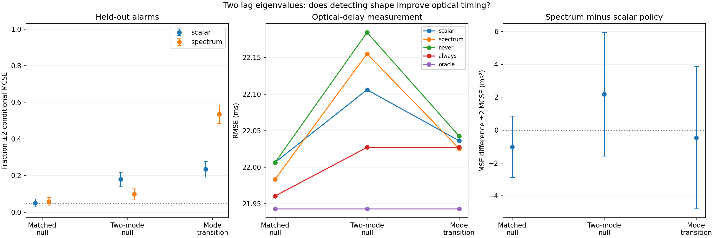

# Fixed-seed results

Seed 20261017; 999 matched-null training pairs, rank950; 400 independent held-out trials per scenario. Thresholds: scalar **0.3069120702**, spectrum **0.4071756762**. Each policy costs 640 pairs per trial (final evaluation data excluded equally). All numerical fits succeeded.

| Scenario | Scalar alarm | Spectrum alarm | Scalar delay RMSE (ms) | Spectrum delay RMSE (ms) | Spectrum − scalar MSE ±2 MCSE (ms²) |
|---|---:|---:|---:|---:|---:|
| matched null | 5.00% | 5.75% | 22.00655 | 21.98346 | -1.016 ± 1.865 |
| two-mode null | 18.00% | 9.75% | 22.10597 | 22.15516 | 2.177 ± 3.760 |
| mode transition | 23.50% | 53.50% | 22.03627 | 22.02567 | -0.467 ± 4.317 |

The first two rows are false alarms; the final row is detection power. Spectrum transition misses are 46.5%, scalar misses 76.5%. The spectrum detector improves detection in this experiment, but every paired MSE difference spans zero within two conditional MCSE. No optical-risk improvement is established. Both alarms lose the matched-null guarantee under stationary two-mode mismatch; the spectrum false-alarm rate of 9.75% is still above nominal. A realized matched-null rate of 5.75% does not contradict a marginal 5% rank guarantee: finite test counts fluctuate, and the fixed training threshold itself is random.

The oracle is the same across scenarios because marginal C and final image/evaluation primitives are identical. The RMSE axis is intentionally zoomed; its small differences must be read alongside paired uncertainty. Freshly estimating a misspecified single rho does not repair the two-mode process.

All 1,200 paired affine-control alarm decisions per detector agree. Maximum absolute score differences:

- scalar: 1.34e-07
- spectrum: 1.8e-14

Optical-center repeatability SD: 0.00027052 px. This is synthetic repeatability under known photometry and read noise, not instrument accuracy.

23 tests pass. Output JSON contains training scores, held-out scores, raw per-policy delay errors, boundary-fit fractions and paired Monte Carlo statistics for inspection.
